# Officina 3D

Macchine da officina da esplorare nel browser, anche dal telefono. Si sceglie la macchina dal menu in alto (o con l'indirizzo `#equilibratrice`, `#smontagomme`, `#eqmatch`, `#smontmatch`):

- **Equilibratrice per ruote auto**: misura davvero lo squilibrio della ruota.
- **Smontagomme con braccio di aiuto**: stallona, smonta, rimonta e gonfia il pneumatico.
- **EqMatch**: l'equilibratrice con il matching di pneumatico e cerchio.
- **SmontMatch**: lo smontagomme che gira il pneumatico sul cerchio per il matching.

Tutte si possono ruotare, sezionare e smontare pezzo per pezzo.

**Prova l'app:** https://www.alessandropezzali.it/officina-3d/

## Comune a tutte le macchine

- **Ruotare e zoomare** la macchina con il dito o il mouse.
- **Sezionare**: un piano di taglio apre la macchina; le superfici tagliate sono tratteggiate come in un disegno tecnico. I pezzi che nello smontaggio escono verso l'operatore restano interi.
- **Smontare**: la vista esplosa separa tutti i gruppi.
- **Toccare un pezzo** per leggere cos'è e a cosa serve, nasconderlo o evidenziarlo.
- **Installarla come app** (PWA) e usarla offline.

## Equilibratrice

- **Misurare**: il carter si abbassa, il motore porta la ruota a 200 giri/min, la macchina legge i sensori per 8 giri, frena e mostra i grammi da mettere sul piano interno ed esterno. Con *Applica pesi* la ruota si posiziona a ore 12 e i pesi vengono agganciati; rilanciando, il display mostra OK.
- **Flussi animati**: forze centrifughe che girano con la ruota, sensori che si illuminano con la forza, segnali che corrono nei cavi verso la scheda, cinghia in movimento.

### La fisica

- Lo squilibrio di ogni piano è un vettore `U = m · r` che genera la forza centrifuga `F = U · ω²`.
- L'albero è una trave su due appoggi (i sensori piezoelettrici A e B): le forze sui sensori si calcolano con l'equilibrio di forze e momenti.
- La macchina simulata non "conosce" lo squilibrio: campiona i segnali dei sensori con rumore, li demodula in modo sincrono con l'angolo dell'encoder e risolve il sistema inverso per ottenere massa e angolo dei due pesi.
- La rotazione segue l'equazione `I · dω/dt = coppia motore − attriti`, con un motore asincrono semplificato e frenatura a controcorrente.

## Smontagomme

Pezzi: mobile, piatto autocentrante con 4 griffe e i loro due cilindri, palo ribaltabile con cilindro di ribaltamento, braccio orizzontale, asta esagonale con bloccaggio pneumatico, utensile di montaggio, leva alzatallone, stallonatore con braccio a gomito e lama curva in acciaio, il suo cilindro, la pulsantiera elettrica e l'elettrovalvola, tamponi, pedaliera (rotazione, griffe, palo), distributori, gruppo filtro-regolatore-lubrificatore, gruppo di gonfiaggio con manometro e pistola, riduttore a vite senza fine, cinghia e motore.

**Stallonatore**: il braccio esce dal fianco del mobile dietro la ruota e corre in avanti fuori dal pneumatico, così solo la lama tocca il fianco, vicino alla balconata. Si comanda dalla pulsantiera sul fianco: STALLONA fa avvicinare la lama, spinge finché il tallone si stacca e riporta indietro il braccio da sola; RITORNO lo riapre subito; ARRESTO ferma tutto e scarica il cilindro. In sezione si vedono i segnali elettrici che corrono nei cavi verso le bobine dell'elettrovalvola e l'aria che va nell'una o nell'altra camera del cilindro.

**Braccio di aiuto (helper)**: colonna propria sul fianco del mobile, bracci girevoli, un cilindro pneumatico per ogni utensile, comando dedicato. Utensili: rullo pressore, disco premitallone e cono di centraggio.

Il ciclo si esegue un passo alla volta o tutto insieme:

1. **Stallonatura** sui due fianchi, dalla pulsantiera: la pressione nel cilindro sale, la lama schiaccia il fianco (il pneumatico si deforma) finché la forza supera la tenuta del tallone; poi la ruota si stacca dai tamponi, si gira e si fa l'altro fianco.
2. **Bloccaggio**: la ruota va sul piatto, il cono di centraggio la preme dal centro, le griffe chiudono.
3. **Smontaggio**: il disco completa lo stallonamento dall'alto, il rullo tiene il tallone nel canale dal lato opposto all'utensile, la leva porta il tallone sopra la lingua e il piatto gira.
4. **Montaggio**: rullo e disco tengono il tallone superiore nel canale mentre il piatto gira (indispensabile con ribassati e run-flat; si può disattivare l'helper per confronto).
5. **Gonfiaggio**: la pressione sale secondo la legge dei gas, i talloni saltano in sede, si arriva alla pressione finale.

In sezione si vedono i pistoni nei cilindri e tutto il circuito dell'aria, con le particelle che mostrano dove va l'aria a ogni comando.

### La fisica

- Forza dei cilindri `F = p · A`, poi la leva dello stallonatore (equilibrio dei momenti attorno al perno).
- Coppia al piatto `C = η · P / ω` dopo cinghia e vite senza fine.
- Gonfiaggio isotermo a volume costante: `dp = p_atm · dV_aria / V`, con portata che cala avvicinandosi alla pressione di linea.

## Matching (EqMatch e SmontMatch)

EqMatch e SmontMatch sono copie indipendenti delle due macchine; equilibratrice e smontagomme restano come prima. Le due macchine nuove condividono la stessa ruota (`src/core/match.ts`): nella simulazione cerchio e pneumatico hanno ciascuno il proprio squilibrio nascosto, e il pneumatico ha un angolo sul cerchio.

1. Dopo la misura, se lo squilibrio statico supera la soglia (predefinita 60 g, indicativa, si cambia nel pannello) EqMatch propone il matching.
2. La valvola va a ore 12: si segna il cerchio alla valvola (giallo) e il pneumatico allineato (bianco). Prima misura M1.
3. SmontMatch gira il pneumatico di 180° sul cerchio: sgonfiaggio, stallonatura dei due talloni, cerchio bloccato dalle griffe, pneumatico tenuto fermo dal disco premitallone e dal **fermo per matching**, piatto che gira il cerchio finché i segni coincidono, poi gonfiaggio e tallonamento. Seconda misura M2.
4. Cerchio `C = (M1 + M2) / 2`, pneumatico `P = (M1 − M2) / 2`, riferiti alla valvola. Il pneumatico va girato di `δ = arg C + 180° − arg P` rispetto alla prima posizione; il residuo previsto è `| |C| − |P| |`.
5. EqMatch mostra sul pneumatico il nuovo segno giallo da portare sul segno del cerchio, con l'arco e l'angolo di rotazione. SmontMatch riceve angolo e segni e fa la rotazione (senza richiesta fa il mezzo giro), poi si torna a EqMatch per la misura di verifica.

Quando il fermo per matching entra in azione la camera lo inquadra da vicino e a fine rotazione torna alla vista di prima (se nel frattempo non la si è girata a mano); la stessa inquadratura si apre scegliendo il fermo dall'elenco dei pezzi.

Il pannello Fisica di EqMatch mostra M1, M2, i vettori di cerchio e pneumatico (calcolati e reali) in un diagramma polare, l'angolo ottimale, il residuo previsto e quello misurato.

## Macchine private da file

Con **＋ Carica macchina**, accanto al menu delle macchine, si apre un file dal dispositivo (anche dal telefono) nel formato `officina-3d-macchina`, descritto in [docs/formato-macchina.md](docs/formato-macchina.md). Per ora il formato descrive equilibratrici: pezzi fatti di forme semplici, tavole e posizioni del catalogo, ordine e direzioni di smontaggio, catalogo ricambi e il collegamento alla simulazione di EqMatch, così misura e matching funzionano come nella macchina pubblica.

- Il file viene solo interpretato (JSON controllato campo per campo), mai eseguito.
- La macchina resta in IndexedDB, **solo su questo dispositivo**: nessuna richiesta di rete, niente cache del service worker, niente nell'indirizzo della pagina. Nel menu è segnata con 📱; **Rimuovi** la cancella.
- Per la macchina caricata ci sono sezione, smontaggio che segue gli ordini del file, etichette **T5·12** con linea di richiamo, scheda del pezzo al tocco, una tavola alla volta ed elenco ricambi con ricerca.
- Le etichette T·pos sono pulsanti: toccandone una si sceglie il suo pezzo (scheda nel pannello Parti e inquadratura); il pezzo si accende in arancio, tutti gli altri diventano grigi e trasparenti, la sua etichetta si ingrandisce e la linea di richiamo diventa spessa e finisce con un pallino sul pezzo, le altre si attenuano. Toccando lo sfondo o con Esc si torna alla vista normale. Col mouse il passaggio sopra un'etichetta illumina il pezzo senza aprire la scheda; sul telefono lo fa il primo tocco, il secondo lo sceglie. Vale anche al contrario: un pezzo scelto dal modello o dall'elenco ricambi accende la sua etichetta.
- Si vedono solo le etichette dei pezzi visibili (non nascosti dalla tavola, non tolti dalla sezione, non coperti da altri pezzi); si dispongono lungo la linea di richiamo senza sovrapporsi e, se non c'è posto, resta nascosta quella del pezzo più piccolo finché non ci si avvicina. Le etichette che cadono nello stesso punto, o di pezzi attaccati come una vite con le sue rondelle, diventano una sola ("T2·8, 9"), con ogni numero toccabile. Sul telefono le aree di tocco sono di almeno 32 px.
- Nel repository non c'è nessuna macchina privata: solo il lettore e una macchina di prova inventata, [docs/esempi/equilibratrice-di-prova.json](docs/esempi/equilibratrice-di-prova.json).

Senza file caricato l'app è quella di sempre.

## Screenshot

Ripresi in Chrome headless durante un giro completo di matching sulla ruota 175/65 R14 e con la macchina di prova caricata da file (`docs/screenshot/`).

| | |
|---|---|
| 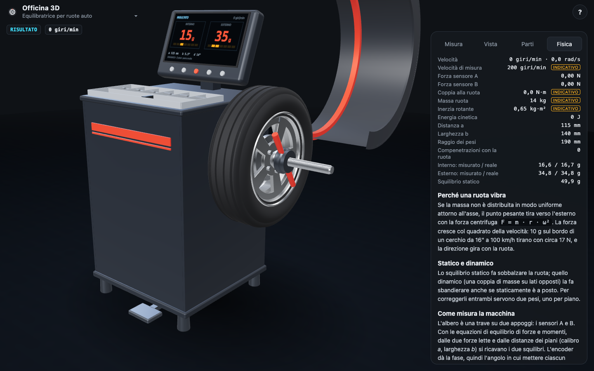 Equilibratrice: misura e pannello Fisica | 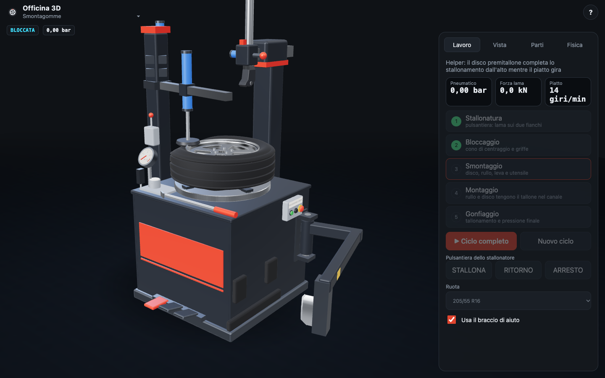 Smontagomme durante il ciclo |
| 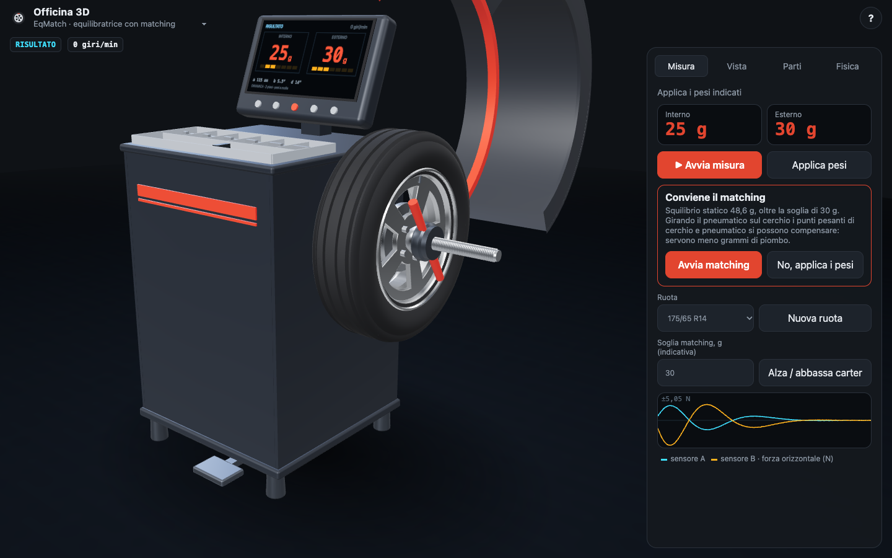 EqMatch propone il matching | 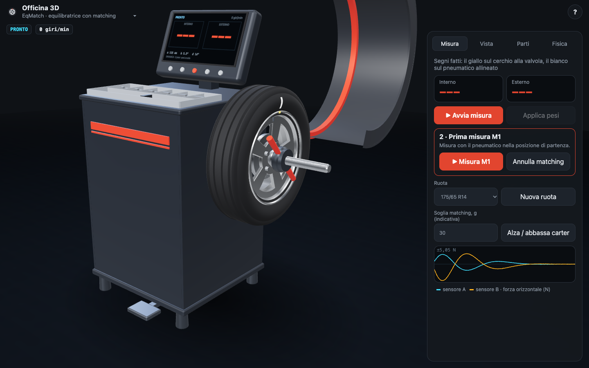 Segni alla valvola |
| 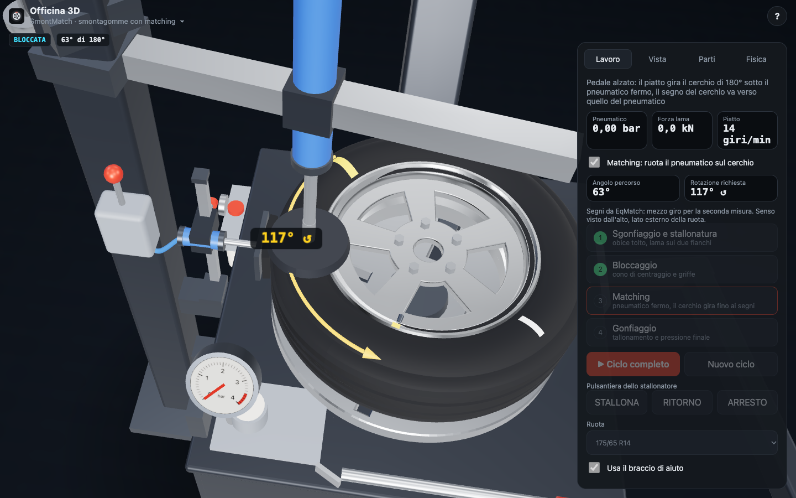 SmontMatch: il fermo tiene il pneumatico, il cerchio gira | 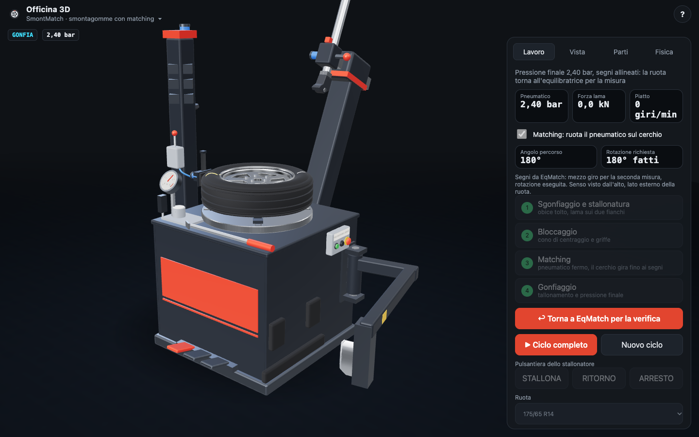 Fine ciclo, ritorno a EqMatch |
| 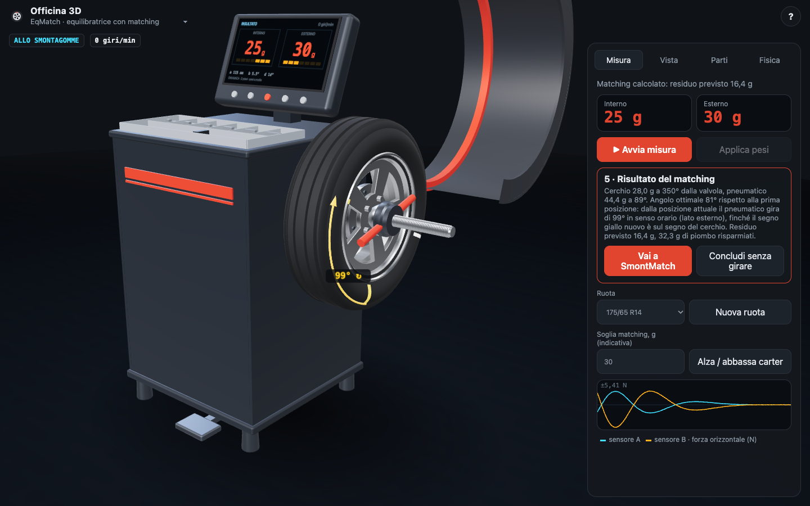 Risultato del matching e rotazione da fare | 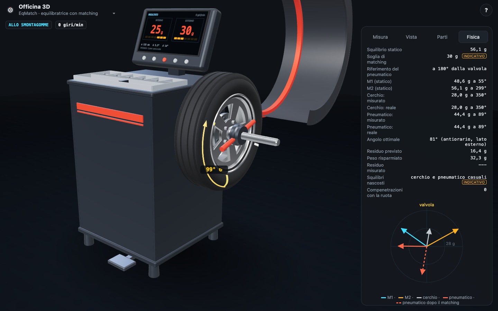 Vettori nel diagramma polare |
| 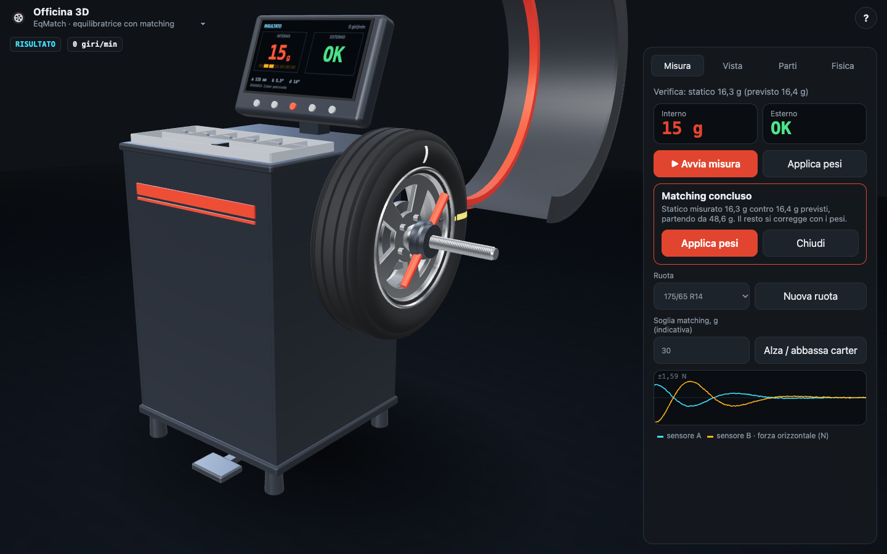 Misura di verifica | 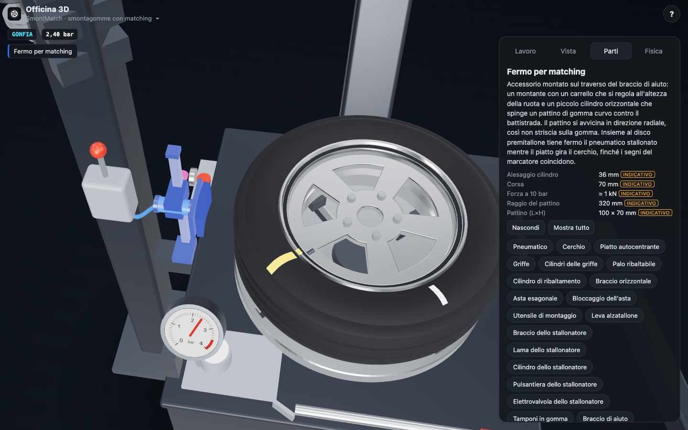 Fermo per matching scelto dall'elenco dei pezzi |
| 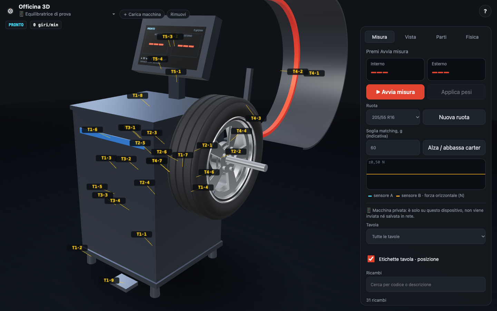 Macchina di prova caricata da file, con le etichette T·pos | 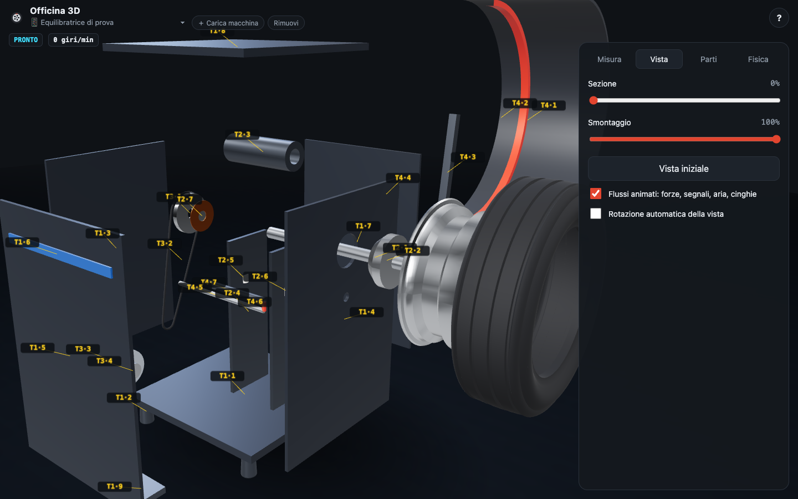 Smontaggio secondo gli ordini del file |
| 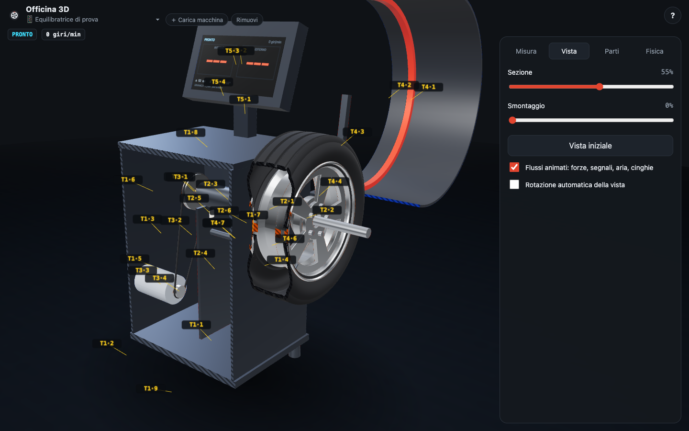 Sezione della macchina caricata | 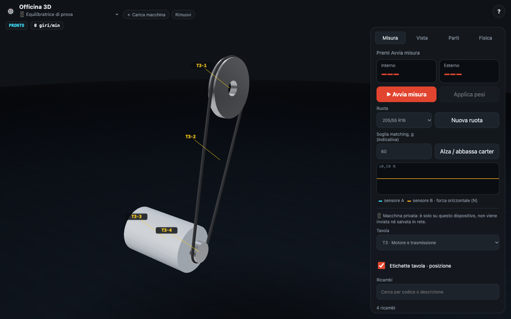 Una tavola alla volta |
| 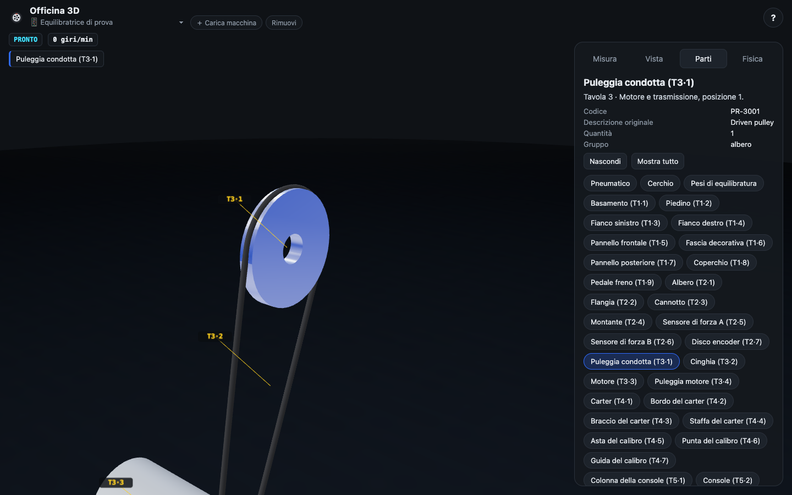 Ricambio scelto dall'elenco: scheda e pezzo nella sua tavola |  Lo smontagomme rimanda la ruota alla macchina privata |
| 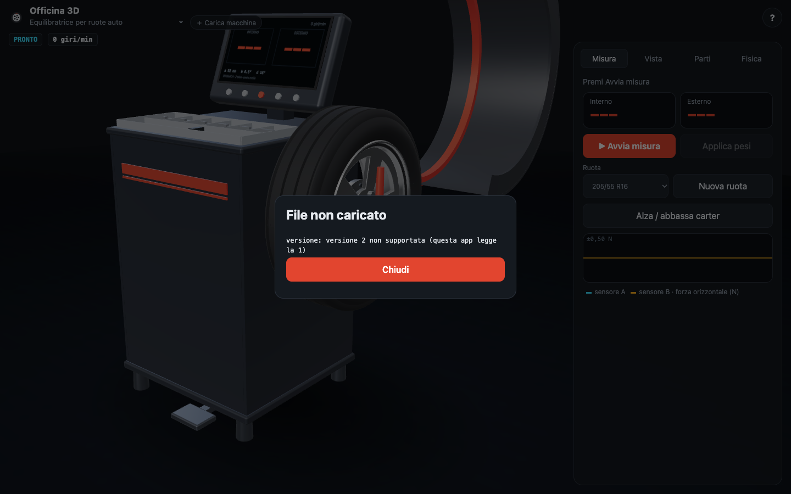 Un file non valido viene rifiutato con il motivo | |

## Valori indicativi

Le dimensioni delle ruote derivano dalla sigla del pneumatico (es. 205/55 R16). Tutti gli altri dati delle macchine (velocità, coppie, potenze, alesaggi dei cilindri, masse, forze di tenuta dei talloni, pressioni di tallonamento, portate...) **sono valori indicativi** e nell'app sono marcati come tali.

## Sviluppo

Servono Node.js 20 o superiore.

```bash
npm install
npm run dev      # server di sviluppo
npm run build    # controllo dei tipi e build in dist/
npm run preview  # anteprima della build
npm run icons    # rigenera le icone PNG della PWA
npm run verifica # verifica automatica delle macchine, poi la misura nel browser (Chromium e WebKit)
```

### Controllo di compenetrazione

Tutte e quattro le macchine controllano durante il ciclo che nessun pezzo entri nella ruota (nelle equilibratrici anche il calibro durante il rilievo): campiona le superfici dei pezzi e prova i punti contro le sezioni di cerchio e pneumatico (tenendo conto di dove il pneumatico è schiacciato dagli utensili). Nel browser segnala in console ogni compenetrazione con passo, pezzo e profondità. `npm run verifica` esegue il ciclo completo su tutte le misure di ruota, con e senza braccio di aiuto, prova la pulsantiera e controlla che l'equilibratrice misuri ancora lo squilibrio giusto. Su equilibratrice ed EqMatch esegue rilievo, misura, pesi e carter con il controllo attivo su tutte le ruote; una prova col calibro spostato di proposito dentro la ruota conferma che il controllo lo vede. Poi esegue il ciclo di SmontMatch senza matching e il matching completo EqMatch → SmontMatch → EqMatch, confrontando cerchio e pneumatico calcolati con quelli reali e il residuo misurato con la previsione. Infine `tools/verifica-browser.mjs` apre l'app in Chromium e in WebKit (il motore di Safari) con [Playwright](https://playwright.dev/), carica la macchina di esempio con **＋ Carica macchina**, preme **Avvia misura** con il carter alzato tenendo premuto il tasto come una persona e aspetta il risultato, controlla che le righe dei ricambi contengano il loro testo, prova le etichette T·pos col mouse e col tocco su un telefono (passaggio, scelta, Esc, scelta dall'elenco ricambi, sezione, nessuna sovrapposizione, aree di tocco di 32 px) e tratta come errore ogni messaggio d'errore in console e ogni richiesta che esce dal server locale. I browser si installano una volta con `npx playwright install chromium webkit`.

Tecnologie: TypeScript, [three.js](https://threejs.org/) e [Vite](https://vitejs.dev/). Tutta la geometria è procedurale, senza file 3D. Nessun servizio esterno, nessun tracciamento, solo font di sistema.

## Pubblicazione

A ogni push su `main` il workflow `.github/workflows/deploy.yml` compila l'app e la pubblica su GitHub Pages (base `/officina-3d/`). Nelle impostazioni del repository, alla voce *Pages*, la sorgente deve essere **GitHub Actions**.

## Struttura

```
src/
  main.ts                 avvio, scelta della macchina, pannello comune, ciclo di animazione
  scene.ts                renderer, luci, camera
  ui.ts                   elementi del pannello e oscilloscopio
  core/machine.ts         interfaccia comune delle macchine
  core/model.ts           base dei modelli: parti, sezione, esplosione, selezione
  core/section.ts         sezione con tratteggio delle superfici tagliate
  core/geo.ts             solidi di rivoluzione e altre geometrie
  core/wheel.ts           misure e geometria di cerchio e pneumatico
  core/interference.ts    controllo di compenetrazione tra macchina e ruota
  core/match.ts           ruota condivisa da EqMatch e SmontMatch: squilibri, angolo, segni
  core/marks.ts           segni del marcatore, arco e angolo di rotazione
  equilibratrice/         modello, fisica, ciclo di misura, display, schede delle parti
  smontagomme/            modello con helper, fisica pneumatica, ciclo di lavoro, schede delle parti
  eqmatch/                copia dell'equilibratrice con la procedura di matching
  smontmatch/             copia dello smontagomme con la rotazione del pneumatico e il fermo per matching
  privata/                lettore delle macchine private: formato, archivio sul dispositivo, modello
public/                   manifest, service worker e icone della PWA
tools/verifica.ts         verifica automatica (npm run verifica)
tools/verifica-browser.mjs  misura nel browser, Chromium e WebKit (npm run verifica)
docs/screenshot/          screenshot delle macchine
docs/formato-macchina.md  formato dei file delle macchine private
docs/esempi/              macchina di prova inventata
```

## Licenza

[MIT](LICENSE) © 2026 Alessandro Pezzali
